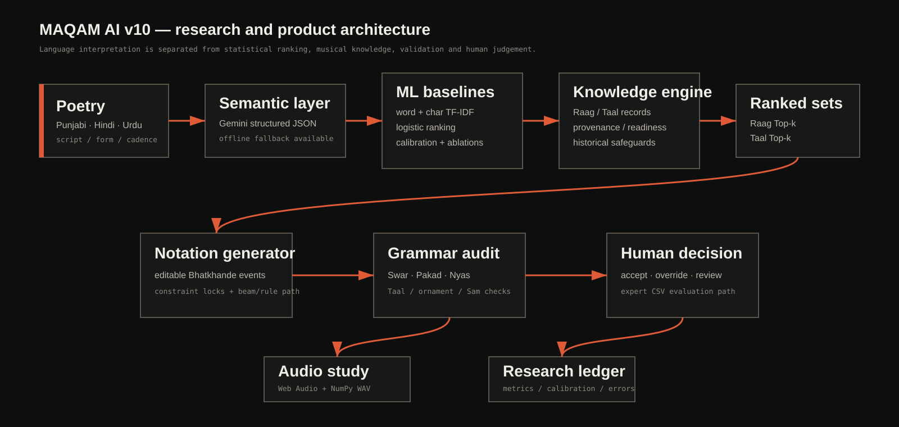
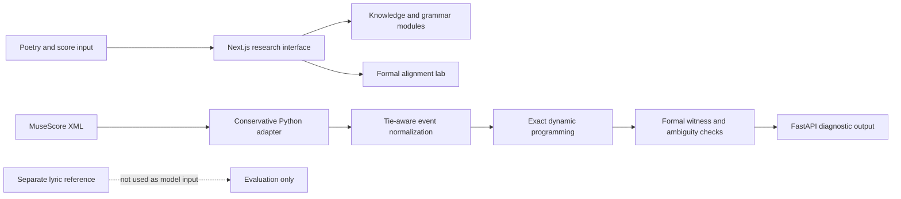

# MAQAM AI

### An explainable computational-musicology research prototype

**Symbolic music · Formal alignment · Raag/Taal knowledge · Reproducible experiments**

> **Research prototype, not a validated singing-alignment system.** The formal algorithms solve their explicitly stated constraints. They do not yet demonstrate reliable syllable-to-note accuracy on unseen performances or independent music annotations.



[](https://github.com/iharkeerat/maqam-ai/actions/workflows/ci.yml)  [Documentation](docs/START_HERE.md) · [Run the demo](docs/GETTING_STARTED.md) · [Research evidence](docs/RESULTS_AND_LIMITATIONS.md) · [MIT License](LICENSE)

## Start here — choose your path

| I'm a… | Read this first | What you'll find |
|---|---|---|
| **Researcher / professor** | [2-minute reviewer guide](docs/REVIEWER_GUIDE.md) | Question, technical approach, verified evidence, and limitations |
| **Student / first-time visitor** | [Getting started](docs/GETTING_STARTED.md) | Installation, guided demo, web interface and troubleshooting |
| **Developer** | [Codebase map](docs/REPO_MAP.md) · [Architecture](docs/ARCHITECTURE.md) | Main files, API, exact DP, parser and tests |
| **Research evaluator** | [Formal method](docs/FORMAL_METHOD.md) · [Verification](docs/VERIFICATION.md) | Reproducible formal claims versus unvalidated musical claims |

**What you can verify in about two minutes:** run `python portfolio_smoke_demo.py` after installing Python dependencies. It tests a *constructed* three-chord example. A real, expert-validated lyric-alignment benchmark is **not** included.

## What is MAQAM?

MAQAM is a software workbench exploring how computational methods can assist with **poetry, symbolic music, notation, and research reproducibility**. It includes a web interface, a Python API, music-knowledge representations, and a deliberately small **formal alignment lab** for testing exact optimization against simple search strategies.

The main design principle is **separating what the algorithm can prove from what the music evidence can support**.

## Explore the project

| Component | What you can try | Evidence boundary |
|---|---|---|
| **Interactive workbench** | Browse Raag/Taal records, experiment with notation and inspect structured constraints | Exploratory recommendations; no artist-validated accuracy |
| **Alignment lab** | Compare Top-1, Top-2, exact DP and budgeted graph search on editable constructed examples | Formal feasibility only; not natural-language pronunciation or sung audio |
| **FastAPI** | Run a symbolic score preview or inspect research endpoints | Deterministic API behaviour tested on constructed XML |
| **Score parser** | Inspect MuseScore `.mscx` written-time events and tie continuations | Unsupported notation rejected rather than silently guessed |
| **Research records** | Review synthetic-baseline methods and published-data compatibility notes | Synthetic results must not be presented as real-world music accuracy |

## Quick demo (Python, 2 commands)

Requires **Python 3.11+**. From this repository's root:

```bash
python -m pip install -r requirements.txt
python portfolio_smoke_demo.py
```

The output is JSON showing a **constructed three-chord score** whose tied pair collapses into one normalized event. It tests the formal API without returning lyric-reference text. **This is a software smoke test, not a musical-accuracy benchmark.**

<details>
<summary>Example output (abridged)</summary>

```json
{
  "original_notated_chords": 3,
  "normalized_events_after_tie_collapse": 2,
  "formal_chord_start_indices": [0, 2],
  "private_lyric_text_absent_from_response": true,
  "unsupported_dtd_rejected_http": 422,
  "real_world_alignment_accuracy_evaluated": false
}
```

</details>

## Run the interactive web app

Requires **Node.js 22+**. Open a terminal at the repository root:

```bash
cd web
npm ci
npm run dev
```

Open **http://localhost:3000**. You can visit:

- `/` — interactive music workbench;
- `/alignment-lab` — formal alignment comparisons;
- `/research` — research results dashboard;
- `/review` — local expert-review interface.

For the optional Python API, use a second terminal from the repository root:

```bash
python -m uvicorn backend.main:app --reload --port 8000
```

API docs: **http://localhost:8000/docs**. The web alignment lab runs with constructed examples and does **not** need an external AI key. An optional server-side Gemini integration may require setting your *own* `GEMINI_API_KEY` in `web/.env.local`; never commit that file.

## Architecture



## Testing

Run the reproducible focused test suite:

```bash
python -m pytest -q \
  tests/test_score_ingestion_v7.py \
  tests/test_score_formal_preview_api_v7.py \
  tests/test_score_timing_integrity_gate_v10.py \
  tests/test_score_timing_api_gate_v10.py \
  tests/test_score_identifiability_v8.py \
  tests/test_locked_identifiability_v10.py \
  tests/test_pointer_cache_api_v9.py
```

These tests check tie handling, rejection of ambiguous timing, exact composition counts, and API sanitization using **constructed fixtures**. They are **not** evidence of correctness on independent song recordings. The CI workflow runs the focused checks; full historical research scripts are kept outside this public portfolio snapshot.

## What we verified — and what we did not

**Verified in the local engineering prototype:** exact formal search, deterministic score projection, separate evaluation references, tie-chain integrity and fail-closed unsupported XML handling. A subset of the code's tests is independently runnable with the commands above.

**Not established:** independently measured accuracy of real-world syllable-to-note alignment; published state-of-the-art improvement; reliable Hindi/Punjabi pronunciation inference; expert-verified artistic recommendations; or general support for polyphonic/overlapping score timelines.

**Public-score inspection:** MAQAM's research process has inspected original OpenScore Lieder `.mscx` files through pinned GitHub blobs. The linked technical evidence brief and source-audit scripts distinguish *connected-source inspection* from *local execution of the full original XML files*. No original scores are needed for the built-in demonstration.

For evidence and reproducibility details, see [Results & limitations](docs/RESULTS_AND_LIMITATIONS.md) and the [technical evidence brief](docs/TECHNICAL_EVIDENCE_BRIEF.pdf).

## Project structure

```text
maqam-ai/
├── web/                      Next.js user interface
├── backend/                  FastAPI endpoints
├── engine/                   Audio synthesis helpers
├── research/                 Formal DP, corpus and score modules
├── models/                   Existing synthetic-baseline artifacts
├── tests/                    Focused verification tests
├── scripts/                  Reproducible formal score demonstrations
├── docs/                     Architecture, evidence and limitations
└── portfolio_smoke_demo.py   One-command executable demonstration
```

## Technical stack

`Python` · `FastAPI` · `NumPy` · `scikit-learn` · `pytest` · `TypeScript` · `React` · `Next.js`

## Provenance, license and safety

- The code retains its existing [MIT license](LICENSE); read the file before publishing under your account.
- Some imported scholarly works, external scores and datasets have **independent licenses**. Do not upload private reviewer materials, third-party music recordings or copyrighted source editions without permission.
- `models/*.joblib` are serialized **synthetic-baseline research artifacts**. Load serialized models only from sources you trust; they are **not** evidence of external performance.
- Do not include real API keys, private `.env` files, academic transcripts, application answers or personal information in this public repository.

## Research focus

This repository is a **technical portfolio and reproducible research prototype**. The long-term scientific question is whether independently available musical and linguistic cues can support robust symbolic syllable-to-note alignment under explicit assumptions. Current engineering results are a foundation for that question, **not its answer**.
