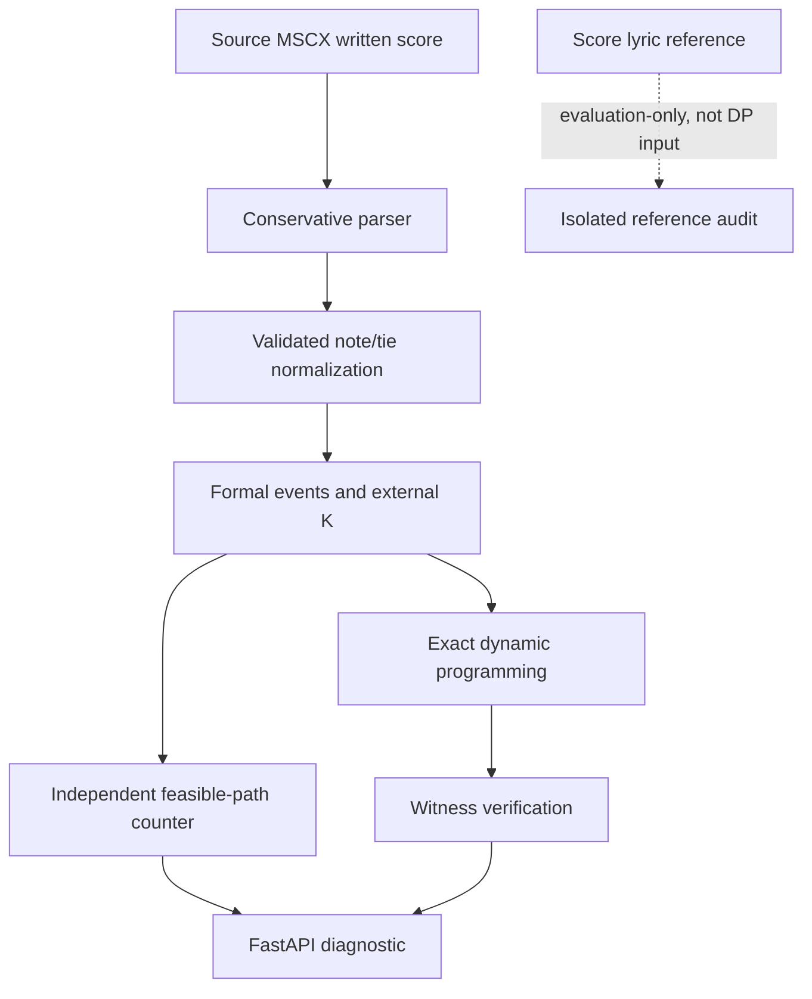

# MAQAM AI — architecture and data flow

There are two related but distinct systems. Neither implies a validated music-accuracy result.

## 1. Browser workbench (`web/`)

The Next.js frontend provides a poetry/music workbench, bundled Raag/Taal data, constraints, notation exploration, a formal alignment lab and research/review pages. The browser primarily uses TypeScript musicology and grammar modules and local curated data. A server-side Gemini pathway is optional; without a configured key, offline analysis is available.

- Main interface: [`web/app/components/MaqamStudio.tsx`](../web/app/components/MaqamStudio.tsx)
- Musicological feature logic: [`web/app/lib/musicology-engine.ts`](../web/app/lib/musicology-engine.ts)
- Constructed formal alignment lab: [`web/app/alignment-lab/page.tsx`](../web/app/alignment-lab/page.tsx)
- Next analysis route: [`web/app/api/analyse/route.ts`](../web/app/api/analyse/route.ts)

## 2. Symbolic-score formal research (`research/`, `backend/`)

- [MSCX parser](../research/score_ingestion/notation_adapter.py) accepts a limited subset of MuseScore v3 and refuses ambiguous timing.
- [Normalization](../research/score_ingestion/integration.py) collapses verified ties and retains original chord indices.
- [Formal core](../research/pronunciation_rhythm/core.py) performs exact constrained optimization.
- [Identifiability](../research/score_ingestion/identifiability.py) counts ambiguity, which must not be mistaken for musical confidence.
- [FastAPI](../backend/main.py) returns sanitized formal diagnostics and rejects unsupported XML; it also offers a synthetic baseline endpoint and experimental synthesis.

## 3. Correctness vs music validity

The parser/DP may be **correct relative to their contract** and still assign a syllable to the wrong real note because the formal objective lacks sufficient linguistic or musical evidence. See [Formal method](FORMAL_METHOD.md) and [Results & limitations](RESULTS_AND_LIMITATIONS.md).

## 4. Running, CI, dependency boundaries

Use the [local quickstart](GETTING_STARTED.md). Python and frontend checks are performed independently in [GitHub Actions](../.github/workflows/ci.yml). Docker Compose is an additional experimental local packaging option, not a published CI-verified deployment. The web frontend does not need an external paid key for its basic constructed alignment lab.
